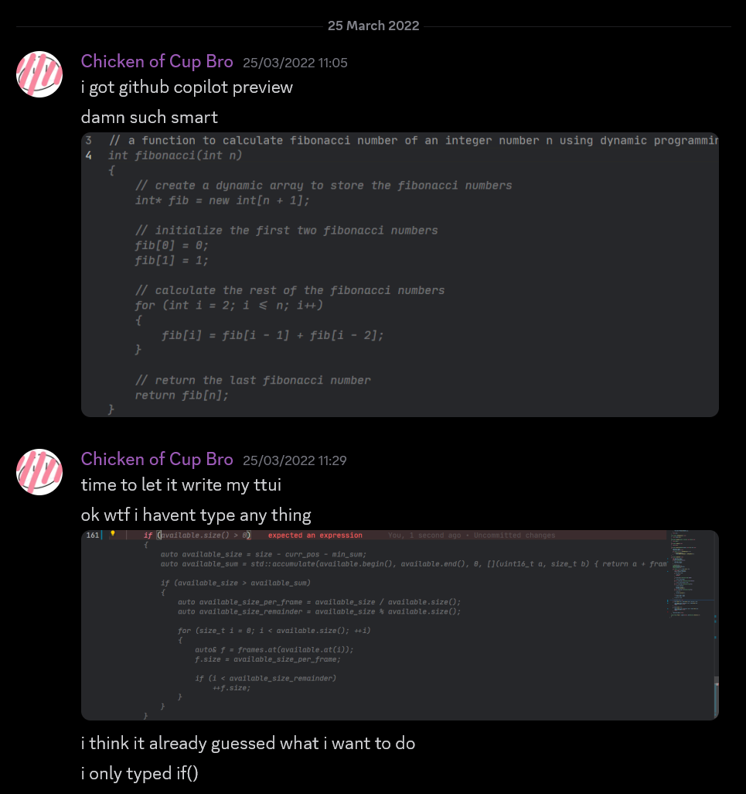
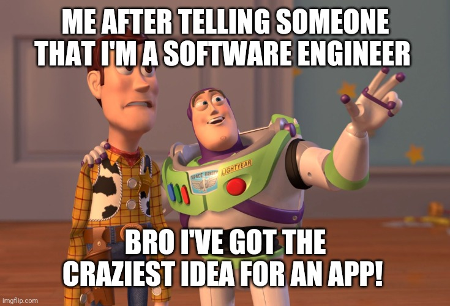

# AI-Assisted Coding Through the Lens of Code Quality

2026-10-13

---

I've been gaining more and more experience on AI-assisted coding in recent years, from using them just for smart auto-completion, to fully vibe-coded projects.

As I predict the rapid improvement AI in coding capability to continue for a while (or Anthropic's IPO flops and the bubble pops), I'd like to write down my thoughts at the moment.

I think it is important to organize my thought, since now AI can generate code much faster than I can understand it. I will need to work on not just getting a functional software, but actually making sure it is maintainable, consistent, and reviewable for me.

> [!IMPORTANT]
>
> For context, the AI mentioned in this post all means Large Language Model (LLM) driven AI unless specified otherwise.

## What I Value in Code

First of all, a note on my values in code. I heavily care about readability, consistent organization, and being able to follow the logic of a codebase. But I don't treat any particular set of clean code rules as absolute.

Here are some basic rules that I try to follow when I am writing code to let you guys have some expectations on what I will present my view on AI-assisted coding.

### The Structural-Behavioral Spectrum

I think of each construct (e.g. functions, classes, interfaces, etc.) in a codebase as having a position in a "Structural-Behavioral" spectrum, on one end "structure" is layouts intended for readability and on the other "behavior" is logics intended for processor to execute.

These are not mutually exclusive categories. A service class can provide an organizational boundary while its methods implement specific behaviors.

- For more structural constructs, they act as boundaries and classifiers to help with readability. So naturally they are **recurring and often easier to follow the pattern**. Some examples are:
  - The software architecture layers: UI (present visual elements), Service (break down complex workflow into downstream calls), Domain (business logics), Data Access (tailored access functions for business logics to use), Database (SQL migration scripts).
  - The Entity-Component-System architecture's elements: Entities (groups of components), Components (real-time data for operations), Systems (core logics to opreate on data).
  - Or simply a static utility class.
- For more behavioral constructs, their **specific behavior benefits from clear boundaries**, so that its logic can be understood without tracing unrelated parts of the system. These are like:
  - Algorithms: Search, Sort, Physics Simulation, Migration Scripts, GPU Shaders.
  - Orchestrator logics: Take layered software architecture, it would be the service layer functions' body to call certain validation methods and clean up methods in a specific order for specific endpoints.
  - Or simply the main function which runs the event loop for a web app.

Finally, a good codebase should always try to be **consistent** in code organization (though not always possible), hence the existence of design and architecture patterns. I call this the macro-structure of a software, where you choose a pattern and try to stick to it throughout.

## My Experience in Using AI for Coding

Okay, that cleans up my point of view on code organization. Let's talk about my experience with AI-assisted coding. I'll just give you a timeline below:

1. **2022** - I started using GitHub Copilot Preview in VSCode for inline auto-completion, it blew me away with how good it is for small snippets and repetitive codes, though not good for complex reasoning still.
2. **2023 to 2024** - I didn't have much change in using AI for coding, but started working on projects that build agentic behaviors by using structured output for tool calling and implementing trendy topics back then like Retrieval Augmented Generation (RAG). One example is my [Talk Your Way Out](https://innoacademy.engg.hku.hk/talk_your_way_out/) student interest group project in the University of Hong Kong.
3. **2025** - I got a software engineer job and I started using AI for larger scale and production softwares, I still mostly use it for test generations and repetitive codes, though sometimes I do use it to generate a first draft of more complicated logics before manually adjusting.
4. **2026** - I finally started trying full-on vibe coded projects, like the [hiking-track-viewer](https://lioqing.com/my-hike-tracker/) I mentioned in [my previous blog](https://lioqing.com/blogs/2026/03/25/how-i-vibe-coded-a-hiking-track-viewer.html). I also started doing more things with AI outside of just implementing code such as research, design, and documentation.

In the last 2 years, I noticed how fast the current AI-assisted coding capability is improving, and it gave me a lot of thoughts, there are both excitements and worries.

## From Inline Auto-Completion to Agentic Engineering

As seen from my experience with AI-assisted coding, I have been through multiple phases in terms of the approach to AI-assisted coding, and I have different thoughts on each.

### Inline Auto-Completion

This was the way when the most popular form of vibe coding used to be just Tab-Tab-Tab. In fact, being the first feature in GitHub Copilot Preview, it was already very impressive to me back then and remained my most used feature of AI-assisted coding for a long time.

*Literally my first reaction to AI inline auto-completion, back in 2022.*

#### Effectiveness in Maintaining Clean Code

It was able to complete blocks of code based on the codebase. It often produce almost the same implementation that I have in mind as soon as I finished the function signature, although sometimes it fails to do that.

Nevertheless, I never had trouble reviewing the AI generated code this way. I would review its code and modify it if needed before the next chunk of sugeested completion.

While this is the most limited way to write AI generated code afaik, it is the most controllable. As the user, you discover the AI generated code in chunks that is usually isolated in scope, contained in specific structural constructs like a function or class body.

As a result, I still find this as the best use of AI in coding if clean code and keeping human-in-the-loop for providioning is the absolute highest priority in your project.

We now have better approach that utilizes prompts to provide clearer objectives to the AI to make sure user's intention is more clearly communicated.

### Chat Generated Code

As the title suggests, this is just asking an LLM chatbot to generate the code for you. It is the foundation for all modern agentic related stuffs.

Its primitive form is what the original ChatGPT vhat interface website already allows, just ask it for a piece of code, and it respond with the code.

#### Effectiveness in Maintaining Clean Code

It's better than inline suggestions in the way that it allows for user to explicitly state their intention.

Of course, that was still very limited, it cannot see surrounding code or execute the code. That is very bad for on-going projects, that if you want to ask for an AI generated code, you need to consider how to pass in the context of your huge project. It was even worse for consistency of the code organization.

### The Rise of Agentic Capabilities

A lot of chat generated code's powers come from the engineering around the chatbot, or what we call the harness nowadays. And I have never used chat generated code without agentic features throughout my experience with AI-assisted coding.

One of the earliest and most fundamental agentic capabilities is function calling (later more widely known as tool calling/use, or simply tools), introduced by OpenAI around 2023. It essentially lets LLM models to call functions by responding structured JSON objects as parameteres to user provided functions, instead of unstructured text.

> [!NOTE]
> 
> Even earlier, there were already attempts at making LLM produce structured JSON output by feeding JSON schemas to the LLM and verifying the schema of the output.
> 
> Repeat until the LLM correctly outputs the response.
>
> And essentially you get a function calling LLM.
> 
> But official supports are probably doing something more clever.

There are more agentic cabapilities developed later on, which can be or not be based around tool calling. Here are some of the most valuable agentic capabilities nowaday:
- Integrated Development Environment (IDE) integrations - AI agent extensions in many IDEs provide tools that provides the AI agent with context around user's opened files, selections, etc.
- RAG - An architecture pattern to use semantic search algorithms on a set of indexed documents for context generation for LLMs to respond with grounded references without bloating the context size.
- Reusable skills (or just skills) - reusable prompts to instruct LLMs to follow.
- Model Context Protocol (MCP) - a standardized protocol to connect an AI agent with external servers for tool discovery and calling.

While not all implementations call them the same, they are used frequently across different IDEs and agent harnesses. 

#### Effectiveness in Maintaining Clean Code

While IDE integrations differ by the IDEs, most of them are created around providing surrounding contexts and user actions. This ensures the AI agents are aware of current codebase and are able to following existing patterns.

Many IDEs like VSCode also supports inline prompting, meaning the user selects a snippet of code and provide a prompt for the AI agent to follow. It solves the issue with inline auto-completion. Though I find using the chat interface with an attached reference to the code snippet more convenient and user friendly.

RAG on the other hand while not as popular in code editors, are still implemented by some. GitHub Copilot and Zed both index the codebase for faster lookup of codes for AI agents. This makes it easier for the AI agent to find concrete downstream or upstream contracts when implementing, avoiding attempt of inference by the agent.

However, the most popular and useful capability nowdays is the MCP servers and skills. Since it is widely supported, that makes it easy to implement and integrate MCP servers. And skills being just text prompts make it easy to have the AI agent to analyze and summarize any existing sessions into a skills to be reused by future sessions.

Some might even say it's better to implement the abovementioned IDE integrations and RAG retrieval functionalities in MCP servers. For example, many IDEs and harnesses have built in shell script/command line interface (CLI) tool for the AI agents, so the agent can just search the codebase through `grep` or `rg`, or even language server protocol (LSP) tool for directly analyzing the syntax/semantics of the code.

Additionally, they can also provide informations from the Internet using web search and fetch MCP servers, for example I use SearXNG as search engine and Context7 as library documentation lookup.

Overall, these agentic capabilities have been the key to making AI coding agents produce more consistent code. They provided the necessary context for the agent to understand established patterns and existing contracts while still keeping human in control of the behaviors.

## Current Limitations

There are definitely still a lot of limitations in the current ecosystem of AI-assisted coding. As we have seen, many concepts like tool calling and CLI use are not novel concepts, but to gain mainstream adoption, they require community efforts.

While standardization and wide adoption are good for the democratization of certain technology, they also to a certain degree suppress other innovations if not carefully implemented.

A good standardization I observed is how MCP created context bloat with large amount of tools and their respective descriptions. And some have come up with nice solutions such as progressive discovery of tools, though they are not widely adopted yet, but I believe will get more wide spread eventually.

This is why I believe open source and community effort are important to such a fast changing ecosystem. We create a tool that is useful, then standardize it in a way that doesn't prevent innovation, then build on top of the foundation and continue to innovate. This has been how academia works for centuries.

## The Full Analysis

So what do I think? Do AI-assisted coding keeps codebase maintainable and consistent? Are AI generated code consistent enough to keep human out of the loop of writing code?

**Short answer**: AI-assisted coding can maintainable, but for projects I expect to maintain myself, I'm still very much not comfortable with no human review. Getting a working software and getting a software I understand are different things.

I believe there are two important factors: scope and human capacity (in terms of understanding the structure and logic flows).

> [!NOTE]
>
> I am going to focus mostly on the maintainability, consistency, and readability of code, but not the correctness of the code. Correctness is a separate topic that is also important, but I believe it is rather domain specific and will add a lot more complexity to the discussion.
>
> I will leave it out of this blog post for now.

### Small Changes are Maintainable

For things like auto-completing a few lines of code or generating a function body, I think it is mostly maintainable and consistent. These are changes that only touches a few lines or a single function.

I would compare small code changes like one step in a cooking recipe. You know what the step is, then you can watch a robot do it and know whether it did it right or wrong.

In these situations, the AI don't create a whole project or a whole module. The code it generates most likely follows existing patterns. The human should also be able to easily understand and review the changes (given that the human has the technical and conceptual understanding). 

Additionally, we usually already have a rough expectation of the code generated. As human, we read the changes and go:
- "yep, this is what I want" then proceed to the next thing
- or "hmm, this variable could be better named this way" and made the small tweaks
- or in worst case "this is totally wrong" and we'll undo then redo the previous change with a different prompt or manually implement the change

### Medium Changes Depends on Human Capacity & Workflow

For a single feature or a small project, I believe it completely depends on the technical understanding and workflow of the author. These are changes that touches multiple files, or multiple components, but still can be well defined in scope.

I would compare medium sized code changes to cooking a dish. If as the human, you know each steps well, then you can probably supervise a robot doing it and pick out what did it do wrong.

Some example of these medium sized changes are one new endpoint with the corresponding database changes, one temporary dashboard UI, or a prototype project involving several components.

Doing it the vibe coding way (no human review) is not possible for me if I want to maintain the code, since I am sure the code will be quite "sloppy" and I'll get irritated by minor inconsistency of the code no matter the quality of the AI agent.

> [!NOTE]
> 
> The minor inconsistency are especially noticable if you or your team use different harnesses or LLM models, as the prompts and model styles are different.
> 
> For example, I find that GPT models always try to write very compact code, meaning no blank lines and no redundant new lines even with surrounding context. I'd have to provide explicit prompts to make sure they output code with blank lines at logic boundaries for readability.

So for these changes, I usually do it in chunks and made sure I understand it. If I don't understand the technical or conceptual details of these changes, I will make sure to learn it before handing it over to the AI. One of the ways I found to be quite useful is to just have a discussion session with the AI agent before telling it to make the move. I have a [guided-learning](https://github.com/LioQing/.agents/blob/master/skills/guided-learning/SKILL.md) skill specifically made for these learning sessions.

### Large Scale Changes are Hard to Determine...

Personally, I have not reached the vibe master status to successfully have AI agents fully generate the code for a large scale changes yet.

I imagine these to be complete features of production systems from endpoints to logics to database changes, or a complete projects like a full-stack website or a 3D game. These are changes that involves many components at the same time, and could be difficult to test thoroughly.

Using the similar cooking related example, this would be like orchestrating the whole kitchen to cook a full course meal. The human involved would have to know the recipes, the ingredients, and the cooking methods. They'll need to know how to organize the steps and timings.

So I imagine in coding, it would require heavy research and planning. Since AI agents write code do much faster than human, we are not able to review and adjust the changes in time. We would probably want to set up the appropriate MCP servers with tools to write and read documentations, and skills to teach the AI agent to connect and use external services for deployments amd database accesses.

That means human review and setups must not be excluded in the development process, and it will be the same for keeping the code clean.

### Temporary/Fun/Proof-Of-Concept Projects

For projects that are very short-term and temporary, I have no issue with vibe coding it.

Being a software engineer, I should understand the importance of estimating the cost-effectiveness of a development process, and for these very limited scoped temporary/fun/proof-of-concept (POC) projects we usually want to get the result as soon as possible without considering the future cost or tech debt. However, back then without AI, when I wants to make a project with a random interesting idea, I would still have to research the feasibility and learn the technology required to implement it.

Hence the Internet meme of business friend telling a software engineer to build a SaaS because he had a "genius" idea without knowing the engineering effort it requires.

Nowadays, we can prototype a project in the matter of a few hours that would have required weeks to months of manual engineering efforts back then.

I think projects like these are reasonable vibe coding projects, and I already have [a few of these](https://github.com/search?q=user%3ALioQing+topic%3Avibe-coded&type=repositories).

If these ever becomes a proper project requiring long term maintenance, how to transition it into a maintaintable project would be a serious question. I haven't try to convert a vibe coded project into a proper one as well, so it would be an interesting thing to learn for me.

> [!NOTE]
> 
> Just random thought:
> 
> I have some projects that I rushed through (written by hand) just to prove the concept and ended up as a proper project that I still maintain to this day ([wgpu-3dgs-viewer](https://crates.io/crate/wgpu-3dgs-viewer) and [LLM Extrnsions for Command Palette](https://github.com/LioQing/llm-extension-for-cmd-pal)).
> 
> Maybe the process for a vibe coded project will be similar.

## Extra Bit - My View on the General AI Situation

Now that we've discussed my views on the maintainability and cleanliness of AI generated code, let's talk about the bigger picture.

I have both worries and excitements for the rapidly evolving AI technology.

### Slop Everywhere

This is definitely one of my biggest worries of the technology.

The ability to easily create softwares and websites sounds great at first. Everyone can create a version of a software or website that they had in mind, they'll also be able to alter any of their softwares using AI agents.

However, I soon realized that it changes people's mindset towards software. After using more frontier AI agents, it becomes easier to think "let's build a software with this feature I want using AI" instead of "let's check if there is existing softwares that does this feature".

It always feel better and seems more "productive" when a software is tailor-made for me by me (by AI agent), than to learn how to use a new software built by someone else that might not match exactly what I want. This feeling or thought can definitely discourage us from learning shared tools, contributing to existing projects, and collaborating with other people.

And then, software standardization and the Internet developments might be much more difficult, which'll be quite a regression from the last few decades.

> [!NOTE]
>
> While not related to software development, in worst case scenario, people could become more and more isolated and egoistic. Everyone will live in their own "dream bubble", with AI agents echoing only what they want to hear.
>
> People would become [AI psychosis](https://en.wikipedia.org/wiki/AI-induced_psychosis) as coined by some people. Or even like the Matrix.

### The Bubble or The Revolution

Another concern I have, albeit probably much more short term and uncertain, is that the current AI hype is a bubble.

It is clear that the current AI development is facing a lot of skepticism. I have a lot of doubts for the current AI development as well. The fact that all of these are basically just the transformer architecture, and that most of the market's hypes comes from only this single technology. It just makes me wonder, is it really possible to bring revolutionary improvement to our society based on just this transform architecture? Is it really worth it to damange our environments like this just to make our life a little bit more convenient?

Well, we don't know if we are really in a bubble, we only realize a trend is a bubble after it has popped. Though I do think at the end it will largely depends on the current frontier AI labs like OpenAI and Anthropics. If we found out running transformer models doesn't actually bring enough value to justify it's cost, then we'll know that this technology might not be really worth it.

But if there comes a second breakthrough in this or related technology, then the current technology could prove to be a stepping stone to there and we'll really be at the next industrial revolution.

> [!NOTE]
>
> As a PC gamer, I am also sad to see that the prime era of PC gaming has probably become the past now.
>
> With the new AI market competing for the same limited hardware resources and supply chain, PC hardwares (especially memory) are becoming so expensive now. Undoubtedly, many of the high-end gaming brands will lose a lot of customers, and PC gaming market is probably going to diminish quite a lot.

### A Bright New Internet

One of the biggest excitements I have about the AI development though, is somewhat a twist of AI psychosis. It also highly related to the topic of this blog post.

Maybe it isn't a psychosis? What if we are still willing to work with other humans, and create an organization, a standardization for AI usage and communication? And what if some protocols/architectures get mainstream adoption that improves our hardwares and softwares drastically?

My operating system course professor in university and a colleague at work both talked about this. The next generation of operating systems (OS) and computer softwares could be completely AI managed. AI could generate low level code for system operations and softwares for the user on the fly. AI would also modify the same low level code as the user changes requirements.

But then, we'll need to really tackle the inconsistency in AI models either by engineering around it or making breakthrough in the model itself to make sure the system is stable. And we'll also need to make sure the AI follows protocols consistently so that the Internet won't be toppled because hallucinating AIs are controlling all of our computers.

## Conclusion

As an engineer, I want to keep myself informed and in control. To do this, I need to analyze both my own and AI agents' abilities, and take up the right responsibility. This may be difficult as it is tempting to just hand everything to AI for us, but I blieve it will be worth it to keep myself away from having AI psychosis.

It is also the same in the bigger picture. As Stan Lee said, with great power comes great responsibility.
